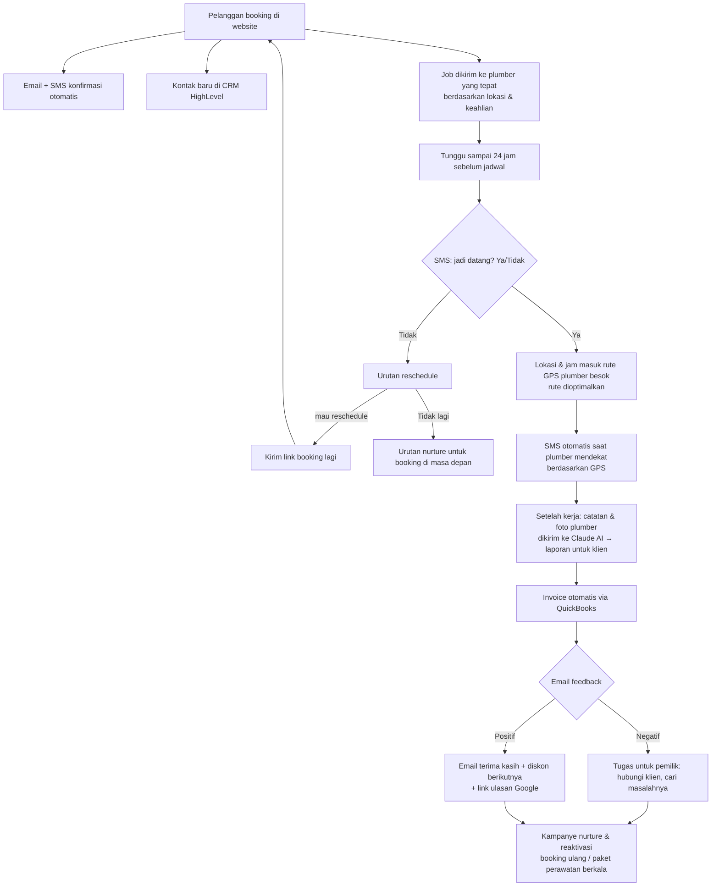

# Automasi Bisnis Jasa: Contoh Alur untuk Tukang Ledeng (Plumber) *(IG)*

> Klaim video: automasi ini bisa dijual ke plumber seharga **$20.000 per tahun**, menjalankan bisnisnya secara autopilot.
> Alasannya: pemilik jasa lapangan sibuk bekerja dan tidak sempat mengurus bisnisnya, jadi mau membayar mahal untuk automasi.

Kaitan: [[WhatsApp Agent - Kapso]] · [[Connector - 5 Connector Wajib untuk Claude]] · [[00 Jualan Website (MOC)]]

## Alur lengkap (dari video)

## Komponen & tools yang disebut
| Tahap | Tools di video | Padanan lokal Indonesia (ide) |
|---|---|---|
| Booking | website plumber | website buatan kita + kalender booking |
| Notifikasi | email + SMS | **WhatsApp** (Kapso / WA Business API), email |
| CRM | **HighLevel** (GoHighLevel) | HighLevel, atau Google Sheets/Supabase untuk klien kecil |
| Penugasan & rute | GPS route optimization | Google Maps (rute), share lokasi WA |
| Laporan kerja | **Claude AI** (catatan + foto → laporan) | sama (Claude API) |
| Invoice | **QuickBooks** | aplikasi akuntansi lokal atau invoice PDF + link Midtrans/Xendit |
| Ulasan | link Google review | **Google Business Profile** (lihat [[SEO - Checklist Supaya Website Muncul di Google]]) |

## Ide penerapan di Indonesia
- **Target:** jasa lapangan seperti servis AC, tukang ledeng, pest control, cuci sofa/karpet, bengkel panggilan, teknisi listrik, **juga servis water treatment / filter air** (relevan dengan bisnis Traya).
- **Paket bertahap** (supaya terjangkau UMKM):
  1. **Basic:** website + booking + konfirmasi WA + pengingat H-1
  2. **Pro:** + CRM, invoice otomatis, permintaan ulasan Google
  3. **Premium:** + penugasan teknisi, rute, laporan kerja AI, kampanye perawatan berkala
- Model harga: **biaya setup + langganan bulanan** (maintenance & biaya tools). Angka $20.000/tahun adalah klaim untuk pasar AS; sesuaikan dengan pasar lokal.
- **Bisa dibangun dengan:** Claude Code + Supabase + WhatsApp (Kapso) + tool automasi (misalnya n8n/Make/Zapier). Tool automasi tidak disebut di video, ini saran tambahan.

## Catatan
- Patuhi aturan WhatsApp (opt-in, template di luar 24 jam). Lihat [[WhatsApp Agent - Kapso]].
- Data pelanggan dan lokasi harus dijaga keamanannya. Lihat [[Keamanan - Checklist Sebelum Launch]].
